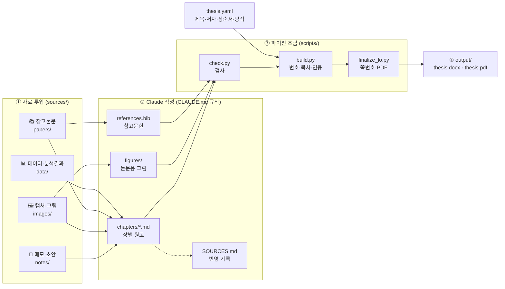

# 학위논문 자동 구성 시스템

자료(메모·캡처·PDF·데이터)를 넣으면 **Claude가 규칙([CLAUDE.md](CLAUDE.md))에 따라 원고를 쓰고**,
**파이썬이 표지·목차·번호·참고문헌까지 갖춘 Word/PDF 논문으로 조립**합니다.

## 전체 흐름



## 완성되는 논문 구성


## 사용법

### 1. 처음 한 번: 논문 정보 입력
[`thesis.yaml`](thesis.yaml) 에서 제목, 이름, 학교, 학과, 지도교수, 날짜를 바꿉니다.
심사위원 서명 페이지(인준지)가 필요하면 `info:` 아래에 추가합니다.

```yaml
  committee: ["위원장 ○○○", "위원 ○○○", "위원 ○○○"]
```

### 2. 자료 넣기 (아무 형식이나)
- 파일을 `sources/` 의 알맞은 폴더에 넣거나, Claude 채팅에 바로 붙여넣기/첨부
- 그리고 **"이 자료 3장 연구방법에 반영해줘"** 처럼 말하면 됩니다. (어디에 넣을지 몰라도 "반영해줘"만 해도 됨)

### 3. 논문 파일 만들기

```bash
python scripts/build.py
```

→ `output/thesis.docx`, `output/thesis.pdf` 생성

### 4. 진행 상황 보기

```bash
python scripts/check.py
```

장별 글자수, 남은 `[TODO]`, 빠진 그림·인용 등을 알려줍니다.

## 자동으로 해주는 것

| 기능 | 원고에 쓰는 법 | 결과물 |
|------|---------------|--------|
| 장·절 번호 | `# 서론`, `## 연구 배경` | 제1장 서론, 1.1 연구 배경 |
| 그림 번호·참조 | `{#fig:model}` / `@fig:model` | 그림 3-1. 연구 모형 / 그림 3-1 |
| 표 번호·참조 | `Table: 일반적 특성 {#tbl:demo}` / `@tbl:demo` | 표 3-1. 일반적 특성 / 표 3-1 |
| 인용·참고문헌 | `[@kim2020]` | (김철수 & 이영희, 2020) + 참고문헌 목록 |
| 목차·그림목차·표목차 | 자동 | 쪽번호 포함 |
| 미완성 표시 | `[TODO: …]` | 굵게 표시 + 검사 시 개수 알림 |

## 폴더 구조

```
paper/
├── CLAUDE.md              # Claude 작성 규칙 (핵심)
├── thesis.yaml            # 논문 정보·장 순서·양식 설정
├── references.bib         # 참고문헌
├── sources/               # ① 자료 투입함
│   ├── SOURCES.md         #    반영 기록
│   ├── notes/ images/ papers/ data/
├── chapters/              # ② 장별 원고 (Markdown)
├── figures/               #    논문에 실리는 그림
├── templates/             #    참고문헌 양식(apa.csl), Word 서식 틀
├── scripts/               # ③ 검사·빌드 프로그램
│   ├── check.py  build.py  make_reference_docx.py  finalize_lo.py  thesis_lib.py
└── output/                # ④ 결과물 (git 제외)
```

## 설치 (내 컴퓨터에서 돌릴 때)

- Python 3.10 이상 → `pip install -r requirements.txt`
- [pandoc](https://pandoc.org/installing.html) 3.x
- [LibreOffice](https://www.libreoffice.org/) (목차 쪽번호 채우기·PDF 변환용, 없으면 Word 파일만 생성)
- 나눔명조·나눔고딕 글꼴 (다른 글꼴은 `thesis.yaml` 의 `style` 에서 변경)

## 학교 양식에 맞추기

`thesis.yaml` 의 `style`(용지·여백·글꼴·줄간격)과 `format`(그림/표 번호 형식, 참고문헌 양식)을 학교 규정에 맞게 바꾸면 됩니다.
더 세밀한 서식은 [`scripts/make_reference_docx.py`](scripts/make_reference_docx.py) 에서 조정합니다.
