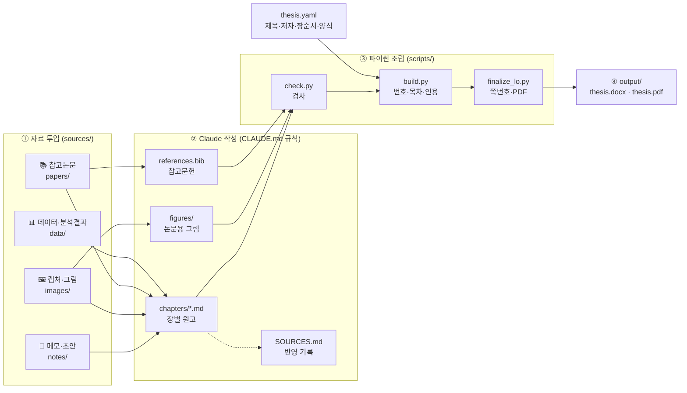
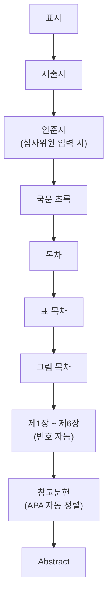

# 박사학위논문 자동 구성 시스템

자료(메모·캡처·PDF·데이터)를 넣으면 **Claude가 규칙([CLAUDE.md](CLAUDE.md))에 따라 원고를 쓰고**,
**파이썬이 표지·목차·번호·참고문헌까지 갖춘 Word/PDF 논문으로 조립**합니다.

## 전체 흐름



## 완성되는 논문 구성



## 사용법

모든 작업은 `thesis.py` 하나로 합니다.

### ★ 가장 쉬운 방법: 입력 화면 열기

```bash
python thesis.py gui
```

브라우저에 **학위논문 작업실** 화면이 열립니다. (끝낼 때는 터미널에서 Ctrl+C)

| 탭 | 하는 일 |
|----|---------|
| ① 기본 정보·주제 | 제목·학교·지도교수·심사위원, 연구 주제·방법·연구 문제·주제어 입력 → 저장 |
| ② 자료 넣기 | **글 직접 입력 / 이미지(캡처를 Ctrl+V 로 붙여넣기·끌어놓기) / 파일** 중 골라서 넣을 장·절 선택 |
| ③ 진행 현황·만들기 | 장별 글자수·남은 TODO, 검사 결과, **Word+PDF 만들기** 버튼 |
| 하단 Claude 입력란 | "대기 자료 반영해줘", "2장 초안 써줘" 같은 요청 → Claude 가 원고를 직접 고침 |

하단 Claude 입력란은 내 컴퓨터에 [Claude Code](https://code.claude.com) 가 설치돼 있으면 원고 파일까지 고쳐 주고,
없으면 `ANTHROPIC_API_KEY` 와 `pip install anthropic` 으로 질문·답변만 할 수 있습니다.

터미널 명령으로 하고 싶으면 아래처럼 해도 됩니다. 그냥 `python thesis.py` 만 치면 번호 메뉴가 나옵니다.

### 1. 처음 한 번: 주제와 기본 정보 입력

```bash
python thesis.py init
```

질문에 차례로 답하면 됩니다: 제목(한/영) → 학위·학교·학과 → 이름·지도교수 → **연구 주제 요약 → 연구 방법 → 연구 문제 → 주제어**.
연구 문제는 1장 「연구 문제」에, 주제어는 국문 초록에 자동으로 들어갑니다.
(심사위원 서명 페이지가 필요하면 `thesis.yaml` 의 `committee` 줄 앞 `#` 을 지우고 이름 입력)

### 2. 자료 넣기 — 텍스트든 이미지든

| 하고 싶은 것 | 명령 |
|-------------|------|
| 질문에 답하며 넣기 | `python thesis.py add` |
| 캡처 이미지를 3장 「연구 설계」에 그림으로 | `python thesis.py add 캡처.png --to 3 --section "연구 설계" --caption "연구 모형"` |
| 메모 파일(.txt/.md/.docx)을 1장 「연구 배경」에 | `python thesis.py add 메모.txt --to 1 --section "연구 배경"` |
| 글을 바로 입력해서 | `python thesis.py add --text "본 연구는 …" --to 1 --section "연구 목적"` |
| 어디 넣을지 모르는 자료(PDF 논문 등) | `python thesis.py add 논문.pdf`  → '대기'로 보관 |

- 넣은 자료의 원본은 `sources/` 에 날짜별로 보관되고, `sources/SOURCES.md` 에 "무엇을 어디에 넣었는지" 기록됩니다.
- 그림은 자동으로 「그림 3-1」처럼 번호가 붙습니다.
- 그 다음 Claude 에게 이렇게 말하면 됩니다.
  - **"대기 자료 반영해줘"**: 보관만 해 둔 자료를 알맞은 장에 정리해 넣습니다.
  - **"방금 넣은 부분 논문체로 다듬어줘"**: 넣은 글을 학술 문체로 다듬습니다.
- 채팅에 글이나 이미지를 바로 붙여넣고 "반영해줘"라고 해도 됩니다.

### 3. 진행 상황 보기 / 논문 파일 만들기

```bash
python thesis.py status
```

```bash
python thesis.py build
```

장별 글자수와 남은 `[TODO]`를 보여 주고, `output/thesis.docx` 와 `output/thesis.pdf` 를 만듭니다.

## 자동으로 해주는 것

| 기능 | 원고에 쓰는 법 | 결과물 |
|------|---------------|--------|
| 장·절 번호 | `# 서론`, `## 연구 배경` | 제1장 서론, 1.1 연구 배경 |
| 그림 번호·참조 | `{#fig:model}` / `@fig:model` | 그림 3-1. 연구 모형 / 그림 3-1 |
| 표 번호·참조 | `Table: 일반적 특성 {#tbl:demo}` / `@tbl:demo` | 표 3-1. 일반적 특성 / 표 3-1 |
| 인용·참고문헌 | `[@kim2020]` | (김철수 & 이영희, 2020) + 참고문헌 목록 |
| 목차·그림목차·표목차 | 자동 | 쪽번호 포함 |
| 쪽번호 | 자동 | 표지·제출지·인준지 없음 → 초록·목차 i, ii… → 본문부터 1, 2… |
| 미완성 표시 | `[TODO: …]` | 굵게 표시 + 검사 시 개수 알림 |

## 입체(3D) 그림 만들기 — Blender

금형·장치 같은 그림은 무료 3D 프로그램 [Blender](https://www.blender.org) 를 파이썬으로 조종해서 그립니다.
스크립트로 남기 때문에 치수를 바꿔 언제든 똑같이 다시 그릴 수 있습니다.

```bash
python scripts/figures/make_figures.py --quick
```

```bash
python scripts/figures/make_figures.py --punch-d 30 --thick 2 --gap 3
```

→ `figures/clearance_3d.png` (반단면 + 간극 확대, 한글 라벨 자동). 위 첫 줄은 빠른 미리보기, 둘째 줄은 치수를 바꾼 고품질 렌더입니다.
유튜브·웹 캡처는 저작권 때문에 그대로 싣지 말고 참고용으로 `sources/images/` 에 넣은 뒤 다시 그리는 것을 권장합니다.

## 폴더 구조

```
paper/
├── thesis.py              # ★ 사용자 도구: 입력 화면(gui)·주제 입력·자료 추가·현황·빌드
├── CLAUDE.md              # Claude 작성 규칙 (핵심)
├── thesis.yaml            # 논문 정보·장 순서·양식 설정
├── references.bib         # 참고문헌
├── sources/               # ① 자료 투입함
│   ├── SOURCES.md         #    반영 기록
│   ├── notes/ images/ papers/ data/
├── chapters/              # ② 장별 원고 (Markdown)
├── figures/               #    논문에 실리는 그림 (scripts/figures/ 로 생성)
├── templates/             #    참고문헌 양식(apa.csl), Word 서식 틀
├── scripts/               # ③ 검사·빌드 프로그램
│   ├── gui.py  gui.html   # 입력 화면 (브라우저)
│   ├── check.py  build.py  make_reference_docx.py  finalize_lo.py  thesis_lib.py
└── output/                # ④ 결과물 (git 제외)
```

## 설치 (내 컴퓨터에서 돌릴 때)

- Python 3.10 이상 → `pip install -r requirements.txt`
- [pandoc](https://pandoc.org/installing.html) 3.x
- [LibreOffice](https://www.libreoffice.org/) (목차 쪽번호 채우기·PDF 변환용, 없으면 Word 파일만 생성)
  - 리눅스는 수식 표시를 위해 `libreoffice-math` 도 설치 (윈도우·맥은 기본 포함)
- 나눔명조·나눔고딕 글꼴 (다른 글꼴은 `thesis.yaml` 의 `style` 에서 변경)

## 학교 양식에 맞추기

`thesis.yaml` 의 `style`(용지·여백·글꼴·줄간격)과 `format`(그림/표 번호 형식, 참고문헌 양식)을 학교 규정에 맞게 바꾸면 됩니다.
더 세밀한 서식은 [`scripts/make_reference_docx.py`](scripts/make_reference_docx.py) 에서 조정합니다.
